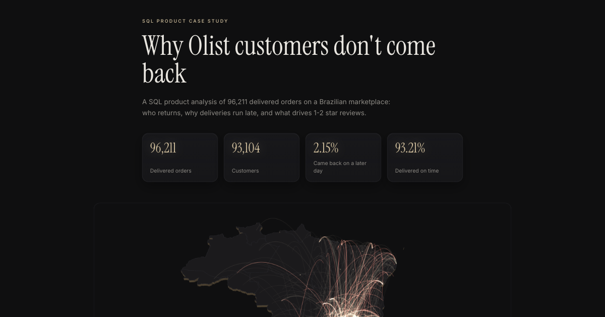

# Olist e-commerce: SQL product analytics

A SQL product analysis of 96,211 delivered orders on a Brazilian marketplace: who
comes back, why deliveries run late, what drives 1-2 star reviews, and three
changes to test.

**Live case study:** _link added after deployment_



The analysis runs in PostgreSQL on the [Olist Brazilian e-commerce dataset](https://www.kaggle.com/datasets/olistbr/brazilian-ecommerce)
(purchases from 2017-01-01 to 2018-08-31). Every number on the site and in this
README comes from query output: `scripts/export_site_data.py` traces each one to
a cell in `results/` and stops if any value doesn't match.

## Findings

| | Finding |
|---|---|
| **F1. Retention** | Only 2.15% of customers came back on a later day, and 29.65% of second orders were placed on the same day as the first. |
| **F2. Delivery** | Orders arrived a median 10 days after purchase against a 24-day promise, but orders handed to the carrier after the seller's shipping limit were late 21.10% of the time, against 5.39%. |
| **F3. Reviews** | The share of 1-2 star reviews rises from 8.98% for orders arriving 7+ days early to 79.27% for orders 8+ days late, and 74.46% of late orders were reviewed before they arrived. |
| **F4. Sellers** | The top 1% of sellers (30 sellers) earned 25.93% of revenue, and 62 sellers account for 55.42% of scorecard late handovers. |
| **F5. Growth and freight** | Jan-Aug 2018 revenue was 141.13% above Jan-Aug 2017, with orders up 139.94% and average order value up 0.49%; freight adds 16.63% to item value, and 53.41% for the cheapest quarter of orders. |

All findings are associations in observational data, not causes. Full write-up:
[docs/findings.md](docs/findings.md) (also as a PDF on the site).

## Recommendations

Each one is a hypothesis with a test design in [docs/findings.md](docs/findings.md), not a proven effect.

| | Change | Target metric | Effort |
|---|---|---|---|
| **R1** | Send the review request after delivery confirmation | Share of 1-2 star reviews on late orders | Low |
| **R2** | Seller handover SLA with alerts and a ranking penalty, starting with the 62 sellers with the most late handovers | Late-handover rate (primary); late-delivery rate (secondary) | Medium |
| **R3** | Win back lapsed high-value one-time customers with a free-freight voucher | Share of targeted customers placing a delivered order within the test window | Medium |

## How to run

Requirements: PostgreSQL 16 or later (`psql`), Python 3.9+ (standard library only),
Node.js 20.19 or later for the site.

**1. Data.** Download the dataset from [Kaggle](https://www.kaggle.com/datasets/olistbr/brazilian-ecommerce)
and put the nine CSVs in `data/` with their original names (`olist_orders_dataset.csv`,
`olist_customers_dataset.csv`, ..., `product_category_name_translation.csv`).

**2. SQL**, from the repo root (the `\copy` paths are relative):

```bash
createdb olist
psql -d olist -f sql/00_schema.sql            # tables and keys
psql -d olist -f sql/01_load.sql              # load the CSVs
psql -d olist -f sql/02_data_quality.sql      # data-quality checks
psql -d olist -f sql/03_clean_views.sql       # clean views + fan-out checks (stops on failure)
psql -d olist -f sql/04_baseline.sql          # baseline metrics -> results/baseline.csv
psql -d olist -f sql/10_retention_cohorts.sql      # F1 retention       -> results/10_*.csv
psql -d olist -f sql/11_delivery_performance.sql   # F2 delivery        -> results/11_*.csv
psql -d olist -f sql/12_review_drivers.sql         # F3 reviews         -> results/12_*.csv
psql -d olist -f sql/13_seller_scorecard.sql       # F4 sellers         -> results/13_*.csv
psql -d olist -f sql/14_revenue_rfm.sql            # F5 revenue and RFM -> results/14_*.csv
psql -d olist -f sql/15_site_support.sql           # site support: pipelines, map sample, checks
```

`results/14_rfm_customers.csv` (one row per customer, 6.2 MB) is not committed and
not used by the site; `sql/14_revenue_rfm.sql` writes it when run.

**3. Site data.** Builds `site/data/*.json` from `results/` and `sql/`, and fails if
any number on the site is not traced to a query result:

```bash
python3 scripts/export_site_data.py
```

**4. Site** (React, Vite, TypeScript, Tailwind, Three.js, D3):

```bash
cd site
npm install
npm run dev      # local dev server
npm run build    # production build in site/dist
```

Supporting scripts:

- `scripts/build_geo.py` builds the state outlines (`site/public/geo/brazil-states.json`)
  from IBGE municipal boundaries published by [tbrugz/geodata-br](https://github.com/tbrugz/geodata-br):
  download `geojson/geojs-100-mun.json` and `README.md` from that repo, then run
  `python3 scripts/build_geo.py <geojs-100-mun.json> <README.md> site/public/geo/brazil-states.json`.
- `scripts/md_to_pdf.py` renders `docs/findings.md` to `site/public/olist-case-study.pdf`
  with headless Chrome.
- `site/scripts/make-og-image.mjs` renders the link-preview image and icons from the
  running dev server. Set `links.site` in `docs/site_copy.json` (or `SITE_URL` at build
  time) to the deployed URL so link previews get an absolute image URL.
- `site/scripts/check-contrast.mjs` (`npm run contrast`) checks text colours against WCAG AA.

## Repo structure

| Path | Contents |
|---|---|
| `sql/` | Numbered SQL scripts, run in order: schema, load, data quality, clean views, baseline, one file per analysis (10-14), site support (15) |
| `results/` | Query output: one CSV per query, plus each script's printed output (`*_output.txt`) |
| `docs/findings.md` | Findings, recommendations with test designs, limitations |
| `docs/data_quality_notes.md` | Data-quality checks and the decisions taken (C1-C12) |
| `docs/site_copy.json` | Site text; numbers are placeholders filled from query results |
| `scripts/` | Export of site data (with the number check), geo build, Markdown to PDF |
| `site/` | The case-study site (React + Vite); `site/data/` holds the exported JSON |
| `netlify.toml` | Netlify build settings for the site |

## SQL techniques

- **CTEs** to name each step of a query so it reads top to bottom.
- **Window functions:** `ROW_NUMBER` (order sequence, latest review, seller rank),
  `LAG` (time to second order, month-over-month change), `NTILE` (value quartiles,
  RFM scores), running `SUM` (concentration curves).
- **`percentile_cont`** for exact medians and percentiles.
- **`FILTER`** for several conditional counts in one pass.
- **Cohort matrix** by first-order month, with unobservable cells left NULL.
- **Fan-out checks** on every clean view (rows = distinct grain keys = expected rows),
  and **DO-block assertions** that stop a script when a check fails.

## Limitations

- The analysis covers purchases from 2017-01-01 to 2018-08-31; 349 orders outside that window are excluded, and a customer's first order means their first delivered order inside the window.
- 827 of 2,789 second orders were placed on the same calendar day as the first, 735 of them within 10 minutes; they are not counted as returns.
- 294 delivered orders have payments that differ from items plus freight by more than one cent; the gap is unexplained. Revenue uses item prices, not payments.
- Stage times exclude 1,344 orders with a negative stage duration and 15 with a missing stage.
- Orders not yet delivered when the data ends have no delivery timing (161 of 6,512 orders from August 2018), so the most recent months may be missing their slowest deliveries.
- Distances are between zip-prefix centres, not addresses; 94,453 of 94,931 single-seller orders had usable coordinates.
- Seller quality metrics (reviews, lateness, handover) use single-seller orders only; 1,272 multi-seller orders with delivery timing are not attributed to a seller.
- Some comparisons rest on few customers: only 103 customers whose first order was late came back. No significance tests were run; differences are described, not tested.
- RFM scores are quartiles (NTILE), so the four one-time segments are each about a quarter of customers by construction; their revenue shares, not their sizes, are the result.
- All findings are associations in observational data from 2016-2018; none shows cause and effect.

Definitions used throughout: revenue is the sum of item prices on delivered orders
(freight reported separately); a customer is `customer_unique_id`; a repeat customer
returned on a later calendar day; on time means delivered on or before the estimated
calendar day. Details and reasons: [docs/data_quality_notes.md](docs/data_quality_notes.md).

## Credits and licences

- **Data:** [Brazilian E-Commerce Public Dataset by Olist](https://www.kaggle.com/datasets/olistbr/brazilian-ecommerce),
  on Kaggle, licensed [CC BY-NC-SA 4.0](https://creativecommons.org/licenses/by-nc-sa/4.0/).
  The raw CSVs are not included in this repo.
- **State boundaries:** IBGE municipal boundaries via [tbrugz/geodata-br](https://github.com/tbrugz/geodata-br),
  [CC0](https://creativecommons.org/publicdomain/zero/1.0/), dissolved into states by `scripts/build_geo.py`.

Built by [Aanchal Routela](https://willowy-druid-25583e.netlify.app/).
